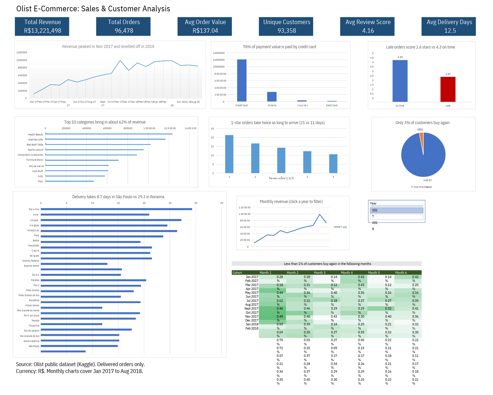

# Olist E-Commerce: Sales & Customer Analysis (SQL + Excel)

An end-to-end analysis of ~100K orders from the Brazilian marketplace Olist. I used **MySQL** to answer business questions, **Excel Power Query** to clean and shape the results, and **PivotTables, charts, and formulas** to build a one-page dashboard.



## Business questions

1. How have revenue and orders changed month by month?
2. Which product categories bring in the most revenue?
3. What share of customers buy more than once, and do they stay?
4. How long does delivery take, and do late deliveries get worse reviews?
5. Which payment methods are most used?

## Key findings

| Area | Finding |
|---|---|
| Overall | R$13.22M revenue from 96,478 delivered orders and 93,358 customers; average order value R$137.04 |
| Revenue trend | Peaked in Nov 2017 (R$988K, 7,289 orders), then levelled off at roughly R$830K to R$980K a month through 2018 |
| Categories | The top 10 categories make up about 62% of revenue; Health & Beauty is #1 (9.3%) |
| Retention | Only about **3%** of customers ordered again (2,801 of 93,358). One-time customers drive 94.5% of revenue |
| Cohorts | In every monthly cohort from Jan 2017 to Feb 2018, less than 1% of customers bought again in any of the next 6 months (maximum 0.72%) |
| Delivery and reviews | Late orders average **2.57 stars vs 4.29** for on-time orders. 1-star orders take about 21 days to arrive vs about 11 days for 5-star orders |
| Geography | Average delivery takes 8.7 days in São Paulo and 29.3 days in Roraima |
| Payments | Credit card is 78.5% of payment value (about 3.5 installments on average); boleto is 18.0% |

Delivery time and review score move together, but this analysis does not prove lateness is the only cause of low ratings.

## Tools and skills

- **SQL (MySQL 8):** multi-table joins, aggregation, CTEs, window functions (`LAG`, `RANK`, `SUM() OVER`), cohort analysis, `LOAD DATA`
- **Excel Power Query:** data types, text cleaning, custom date columns, filtering, merge (lookup), pivot
- **Excel:** PivotTable with slicer and PivotChart, `INDEX/MATCH`, `IFERROR`, conditional formatting (cohort heatmap), KPI cards, dashboard layout

## Method

1. Loaded the 7 relevant Olist tables into MySQL and checked every row count against the source files.
2. Wrote one SQL query per business question and exported each result to CSV (`exports/`).
3. Loaded the CSVs into Excel with Power Query and cleaned them.
4. Built charts, a cohort retention heatmap, and KPI cards on one dashboard.

## Data decisions

- **Only `delivered` orders** are counted, so canceled and unfinished orders do not inflate revenue.
- **Revenue = sum of item `price`**; freight is excluded.
- **Customers are counted with `customer_unique_id`**, not `customer_id`, because `customer_id` is created per order.
- **Monthly charts cover Jan 2017 to Aug 2018.** Sep, Oct, and Dec 2016 were removed because they have 1, 265, and 1 order. This is why the monthly total (R$13.18M) is slightly lower than the full total (R$13.22M).
- Month-over-month growth is recalculated in Excel because the SQL value for Jan 2017 was compared with a nearly empty Dec 2016.
- 99,223 of 99,224 reviews loaded (one row was dropped by the import parser). The effect on results is negligible.
- 8 delivered orders have no delivery date and are excluded from delivery-time results.
- Cohort retention is shown only for cohorts with a full 6 months of follow-up (Jan 2017 to Feb 2018).
- Delivery days use `DATEDIFF`, which counts whole calendar days.

## Repository structure

```
olist-sql-excel-analysis/
├── README.md
├── sql/
│   ├── 01_create_tables.sql
│   ├── 02_load_data.sql
│   └── 03_analysis_queries.sql
├── exports/            # CSV results of each query
├── excel/
│   └── olist_dashboard.xlsx
└── images/
    └── dashboard.png
```

## How to reproduce

1. Download the dataset from Kaggle: *Brazilian E-Commerce Public Dataset by Olist* (not included in this repo).
2. Run `sql/01_create_tables.sql`, then `sql/02_load_data.sql` (update the file paths and enable `local_infile`).
3. Run the queries in `sql/03_analysis_queries.sql` and export the results.
4. Open `excel/olist_dashboard.xlsx` and refresh the Power Query connections.

## Limitations

- The data covers Sep 2016 to Sep 2018 only and is not recent.
- Retention is measured within the data window, and customers could have returned after it ended.
- Findings show association, not cause.

## Source

Olist public dataset (Kaggle). Currency: Brazilian Reais (R$).

**Author:** AYUSHI THAKUR | www.linkedin.com/in/ayushi-thakur2165
